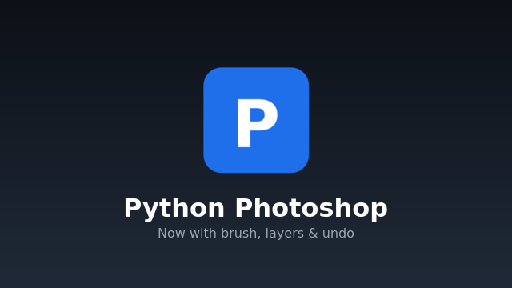

cat > ~/python_photoshop/README.md << 'EOF'
# Python Photoshop

A PyQt5-based image editor with **real-time LAN collaboration**, written in Python. Not affiliated with Adobe — just inspired by the layout.



---

## ✨ Features

### 🎨 Editing
- **13 tools** — Grab, Brush, Pencil, Eraser, Blur, Bucket, Lasso, Text, Image, Shape, 3D Brush, Color Picker, Pan
- **Two kinds of layers** — pixel layers *and* shape layers (text, images, rectangles, ellipses)
- **Selection handles** — click any shape to select, drag corners to resize
- **Non-destructive effects** — Glow, Hue shift, Blur, Sharpen, Brightness/Contrast, Grayscale, Sepia
- **Background removal** — via `rembg` (AI) or ImageMagick fallback
- **Full undo / redo** — per tab, one step per stroke
- **Multi-tab workspace** — open multiple documents at once
- **Save / Save As / Save a Copy / Export** — PNG, JPEG, WebP
- **Autosave + crash recovery** — session locks and autosave snapshots protect your work

### 🌐 Collaboration (LAN)
- **Zeroconf discovery** — hosts appear instantly in a lobby, no IP typing
- **Real-time sync** of layers, shapes, text, images, strokes, chat
- **Bidirectional** — anyone can edit anything
- **Live cursors** with names
- **Chat panel** for each session
- **Host publish** — clients get a modal to save + continue, or disconnect
- Works over LAN, no server setup required

### 🎛️ Polish
- **6 themes** — Dark, Light, Black, Red, Orange, Gold
- **19 procedurally-synthesized sounds** — no audio files shipped, everything is numpy math
- **Speed-reactive brush loop** — the faster you draw, the louder the scratch
- **Preferences dialog** with persistent settings
- **Real progress splash** tied to actual startup steps
- **Selection outline + corner handles** for every shape

---

## 📥 Install

### Arch Linux (recommended)
```bash
sudo pacman -S python-pyqt5 qt5-multimedia python-zeroconf python-numpy imagemagick librsvg
