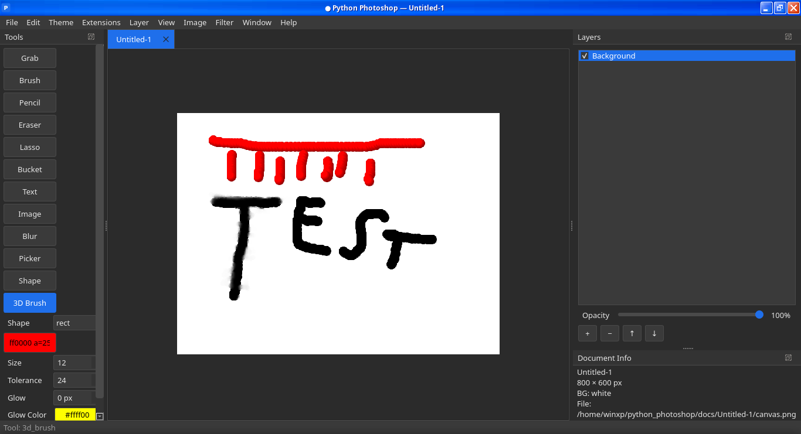
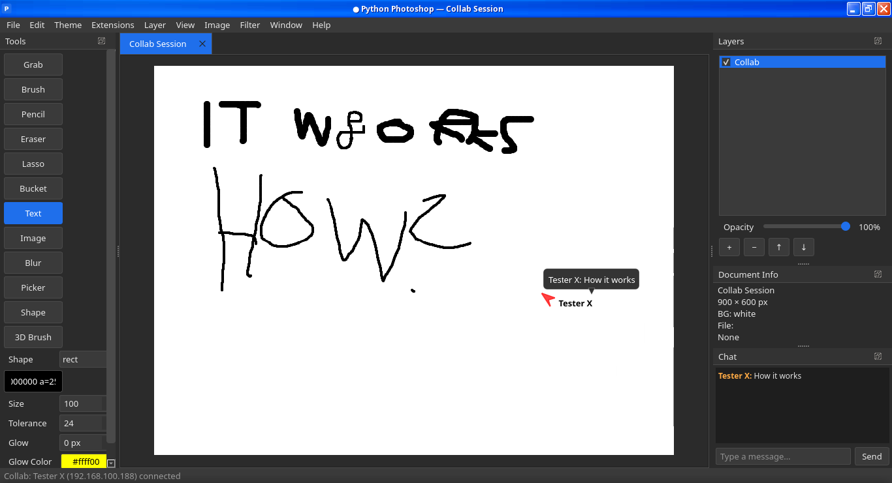

# Python Photoshop

A PyQt5-based image editor with **real-time LAN collaboration**, written in Python. Not affiliated with Adobe — just inspired by the layout.






---

## ✨ Features

### 🎨 Editing
- 13 tools — Grab, Brush, Pencil, Eraser, Blur, Bucket, Lasso, Text, Image, Shape, 3D Brush, Color Picker, Pan
- Two kinds of layers — pixel layers and shape layers
- Selection handles — resize any shape
- Non-destructive effects — Glow, Hue, Blur, Sharpen, Grayscale, Sepia
- Background removal — rembg or ImageMagick
- Full undo / redo per tab
- Multi-tab workspace
- Save / Save As / Save a Copy / Export (PNG, JPEG, WebP)
- Autosave + crash recovery

### 🌐 Collaboration
- Zeroconf discovery — hosts appear in a lobby
- Real-time sync of layers, shapes, text, images, strokes, chat
- Bidirectional editing
- Live cursors with names
- Chat panel per session
- Host publish with client confirm

### 🎛️ Polish
- Live auto-updater — checks GitHub every 15s
- 6 themes — Dark, Light, Black, Red, Orange, Gold
- 19 procedural sounds (numpy)
- Speed-reactive brush loop
- Preferences dialog
- Real progress splash

---

## 📥 Install

### One-line installer
```
mkdir -p ~/PythonPhotoshop && cd ~/PythonPhotoshop
curl -O https://raw.githubusercontent.com/CharWorks112/Python-Photoshop/main/updater.py
python updater.py
```

### Arch Linux
```
sudo pacman -S python-pyqt5 qt5-multimedia python-zeroconf python-numpy imagemagick librsvg
git clone https://github.com/CharWorks112/Python-Photoshop.git
cd Python-Photoshop && python main.py
```

### Debian / Ubuntu
```
sudo apt install python3-pyqt5 python3-pyqt5.qtmultimedia python3-zeroconf python3-numpy imagemagick librsvg2-bin
git clone https://github.com/CharWorks112/Python-Photoshop.git
cd Python-Photoshop && python main.py
```

### Any platform (pip)
```
pip install PyQt5 zeroconf numpy
git clone https://github.com/CharWorks112/Python-Photoshop.git
cd Python-Photoshop && python main.py
```

---

## 🚀 Run

```
python updater.py   # recommended — auto-updates and launches
python main.py      # or launch directly
```

---

## 🎓 Tutorial

New here? Follow along — 10 minutes from install to collaboration.

### 1️⃣ First launch

Run `python main.py`. You will see a splash, then an empty workspace:

- Left dock — tools
- Right dock — layers
- Center — canvas
- Top menu bar — File, Edit, Image, Filter, View, Window, Help, Theme, Extensions

If ImageMagick is missing, the status bar warns you.

### 2️⃣ Create your first document

1. Press Ctrl+N
2. Pick a preset (or custom dimensions)
3. Choose background: white, black, or transparent
4. Click OK

A new tab appears with a Background layer.

### 3️⃣ Draw something

1. Press B to select the Brush
2. Click Color in the left dock
3. Set Size (try 20)
4. Click and drag on the canvas

Other tools: P Pencil, E Eraser, R Blur, G Bucket, L Lasso, J 3D Brush

### 4️⃣ Work with layers

- Add: Ctrl+Shift+N
- Reorder: drag in the list
- Hide/show: click the checkbox
- Opacity: drag the slider
- Delete: Ctrl+Shift+Del
- Rasterize: Ctrl+Shift+R

### 5️⃣ Add text

1. Press T
2. Click on canvas
3. Type text, choose font + size, click OK

Text stays editable: double-click to edit, Ctrl+Alt+P for shape properties, V to move.

### 6️⃣ Import images

1. Press I
2. Click canvas
3. Browse to a file (PNG, JPG, SVG, WebP, TIFF, GIF, HEIC)
4. Adjust Scale %, Rotate
5. Apply effects: Grayscale, Sepia, Blur, Sharpen, Brightness, Contrast, Hue shift
6. Click preview to paint on the image
7. Click Done — effects apply on top
8. Click Import

Remove background: Image menu -> Remove Background

### 7️⃣ Draw shapes

1. Press U
2. Pick rect or ellipse
3. Drag on canvas

Gradient fill: Shape Properties (Ctrl+Alt+P) -> check Gradient -> pick colors + angle.

### 8️⃣ Add effects

Glow: select shape -> set Glow radius -> pick color -> Apply Glow to Selection

Image filters: Filter menu -> Blur, Sharpen, Brightness/Contrast, Grayscale, Sepia

Live effects: double-click an image -> change Hue/Blur/Brightness

### 9️⃣ Save and export

- Save (Ctrl+S) — to docs/<project>/
- Save a Copy (Ctrl+Shift+S)
- Export As (Ctrl+E) — PNG / JPEG / WebP

Autosave every 30s -> crash recovery on next launch.

### 🔟 Set up multiplayer

Prerequisites: two machines on same LAN, zeroconf installed on both, firewall allows TCP 51000 + UDP 5353.

HOST:
1. Launch app, create or open a document
2. Extensions -> Collab Paint (Ctrl+Shift+P)
3. Type your name -> Host a Session

CLIENT:
1. Launch app
2. Extensions -> Collab Paint (Ctrl+Shift+P)
3. Type your name -> Join a Session
4. Host appears in list within 1-2s
5. Double-click the session

Client canvas fills with host project within ~300ms.

What syncs: strokes, layers, text, images, shapes, chat, cursors, filters.
What does not sync: undo (per-side), files.

Publishing: Host clicks Publish -> clients get Continue / Disconnect.

### 🔄 Keep up to date

Always launch through `updater.py` — it turns on live auto-updates:

```
python updater.py
```

The updater:
1. Installs the app if missing
2. Syncs changed files at startup
3. Watches GitHub every 15 seconds
4. When an update appears -> Update Available dialog
5. Saves your session (tabs, layers, tool state)
6. Closes -> downloads -> relaunches -> restores your session

If you launch `python main.py` directly, auto-update is disabled.

---

## 🤝 Collaboration (quick reference)

Host: Ctrl+N -> Extensions -> Collab Paint -> Host -> name

Join: Extensions -> Collab Paint -> Join -> double-click a session

Publish: Extensions -> Publish Collab Session

---

## ⌨️ Keyboard shortcuts

| Shortcut | Action |
|---|---|
| Ctrl+N / Ctrl+O / Ctrl+S / Ctrl+E / Ctrl+W | New / Open / Save / Export / Close tab |
| Ctrl+Z / Ctrl+Shift+Z | Undo / Redo |
| Ctrl+Alt+P | Shape properties |
| Ctrl+Shift+P | Collab lobby |
| Ctrl+, | Preferences |
| Ctrl+0 / Ctrl+1 | Fit / 100% |
| Space + Drag | Pan |
| Alt+Click | Color pick |

Tools: V Grab, B Brush, P Pencil, E Eraser, R Blur, G Bucket, L Lasso, T Text, I Image, U Shape, J 3D Brush, K Color Picker

---

## 🖼️ Screenshots

Splash

Editor

Live collaboration

---

## 🔄 Updater

Updater is both installer and live supervisor. Launch through it and it checks GitHub every 15 seconds.

| Situation | Action |
|---|---|
| App not installed | Downloads full repo, installs packages, launches |
| App outdated at startup | Downloads changed files, launches |
| App running, update found | Signals app -> Update Available dialog |
| User accepts | Saves session -> app closes -> downloads -> relaunches with --restore-session |
| User declines | Nothing happens, next poll in 15s |
| App exits normally | Updater shuts down cleanly |

Session backup: click Yes on update:
1. Unsaved changes -> save prompt
2. Every tab serialized to ~/.python_photoshop_session.json
3. App closes
4. Updater downloads
5. New app launches with --restore-session
6. Every tab comes back

---

## 🛠️ How it works

- Canvas — QGraphicsView with per-layer QImage compositing
- Layers — pixel layers (QImage) and shape layers (ShapeObject list)
- Effects — ImageMagick CLI round-trips
- Shapes — non-destructive; re-rendered every frame
- Collaboration — TCP + Zeroconf + per-layer snapshots + JSON structure messages
- Undo — QUndoStack per tab
- Sounds — numpy-synthesized at first launch

---

## 📁 Project structure

```
python_photoshop/
|-- main.py              # entry point
|-- updater.py           # installer + supervisor + auto-update
|-- ui/                  # widgets and dialogs
|-- core/                # layer models, commands, image ops
|-- extensions/collab/   # LAN collaboration
|-- assets/              # logo, splash, icon
|-- docs/                # user projects (git-ignored)
```

---

## 🐛 Troubleshooting

| Problem | Solution |
|---|---|
| Gtk-WARNING theme parsing error | Cosmetic — try QT_STYLE_OVERRIDE=fusion python main.py |
| Sounds don't play | Install qt5-multimedia (Arch) or python3-pyqt5.qtmultimedia (Debian) |
| ImageMagick not found | sudo pacman -S imagemagick |
| Effects return blank images | Install librsvg for SVG |
| zeroconf not found | sudo pacman -S python-zeroconf |
| Collab lobby empty | Firewall UDP 5353 (mDNS). Disable VPN. |
| Client behind even after update | Delete .updater_state.json |
| Crash recovery on every launch | Delete docs/<project>/.session.lock |
| Update dialog doesn't appear | Launch with python updater.py (not python main.py) |
| Update fails after Yes | Check updater terminal |
| Session not restored | Check updater terminal |

---

## 📜 License

MIT — see LICENSE.

---

**Built with Python, PyQt5, ImageMagick, and Zeroconf.**
